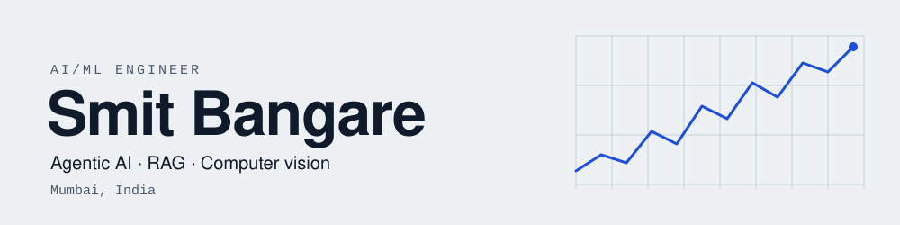

<picture>
  <source media="(prefers-color-scheme: dark)" srcset="assets/banner-dark.svg">
  
</picture>

  
  
  

I build agentic AI, retrieval and computer vision systems, from the model to the API and the container. My work so far covers a maritime AI copilot, research at TIFR, and ML systems deployed end to end.

I'm open to AI/ML engineering roles.

## What I work on

| Agentic AI | RAG | Computer vision |
| --- | --- | --- |
| Multi-agent orchestration in LangGraph, with confidence-based handoffs and a human check before anything is final. | Hybrid search (BM25 plus dense vectors) in Qdrant, with cross-encoder reranking. | CNN and transformer models for edge detection and chest X-ray analysis. |

## Experience

| Role | Organisation | Period | What I did |
| --- | --- | --- | --- |
| AI/ML Engineer | Tech Shipping OPC | Jun 2025 – Aug 2026 | Maritime AI copilot, RAG, predictive ML |
| Research Intern | TIFR | Jan – May 2026 | DC beamline magnet calibration, sub-1% error |
| ML Intern | Unified Mentor | Dec 2024 – Jan 2025 | Predictive models and dashboards |
| Research Intern | Skylark Realty | Jun – Aug 2024 | HVAC load forecasting with PatchTST |

## Featured projects

<table>
  <tr>
    <td valign="top" width="50%">
      <b><a href="https://github.com/SmitBangare/Critical-AI-Capestone">Multi-Agent Medical Imaging</a></b> 
      LangGraph · Qdrant · FastAPI · Docker 
      Agents that read chest X-rays, assess sepsis risk and answer medical questions, with guardrails and review by a medical professional.
    </td>
    <td valign="top" width="50%">
      <b><a href="https://github.com/SmitBangare/Trading-Sentinel">Trading Sentinel</a></b> 
      FastAPI · Node.js · React · Fyers 
      An algorithmic-trading system with risk gates, paper trading by default, Telegram alerts and a backtester that replays real candle history.
    </td>
  </tr>
  <tr>
    <td valign="top" width="50%">
      <b><a href="https://github.com/SmitBangare/VigilPay">VigilPay</a></b> · Smart India Hackathon 2024 finalist 
      Next.js · MongoDB · Tailwind 
      Fraud prevention for Indian payments, with risk scoring that adapts to regional merchant trust and festival periods.
    </td>
    <td valign="top" width="50%">
      <b><a href="https://github.com/SmitBangare/Contextual-Edge-Detection">Context-Aware Edge Detection</a></b> 
      PyTorch · ResNet50 · Transformers 
      An edge detector that adds transformer refinement and attention gates to a ResNet50 backbone.
    </td>
  </tr>
  <tr>
    <td valign="top" width="50%">
      <b><a href="https://github.com/SmitBangare/HVAC_optimization">HVAC Load Forecasting</a></b> 
      PatchTST · TSai · PyTorch 
      Forecasts cooling load in kWh from 46 weather, occupancy and zone features over 48 time steps.
    </td>
    <td valign="top" width="50%">
      <b><a href="https://github.com/SmitBangare/DC-Beamline-Magnet-Calibration-TIFR">TIFR Magnet Calibration</a></b> 
      Python · Physics-based regression 
      Calibration of DC beamline magnets from my research internship, evaluated with leave-one-out cross-validation.
    </td>
  </tr>
</table>

More: [Aeronext HVAC Platform](https://github.com/SmitBangare/Aeronext) · [Diet Recommendation System](https://github.com/SmitBangare/Diet-Reccomendation-System-for-Healthy-Lifestyle)

## Skills

## Education

**B.Tech, Electronics and Computer Engineering**, K. J. Somaiya College of Engineering, Mumbai
2022 – 2026 · CGPA 8.43 / 10

## GitHub activity

  
  

---

Mumbai, India · Open to AI/ML engineering opportunities

