<picture>
  <source media="(prefers-color-scheme: dark)" srcset="assets/hero-dark.svg">
  
</picture>

<picture>
  <source media="(prefers-color-scheme: dark)" srcset="assets/typing-dark.svg">
  
</picture>

  
  
  
  

I build agentic AI, retrieval and computer vision systems, from the model to the API and the container. Most recently I built **ChandleryOS**, the operations system a Mumbai ship chandler now runs on. Before that: research at **TIFR**, a **Smart India Hackathon 2024** finalist project, and ML systems deployed end to end.

<picture>
  <source media="(prefers-color-scheme: dark)" srcset="assets/highlights-dark.svg">
  
</picture>

## What I work on

| 🤖 Agentic AI | 🔎 RAG | 👁️ Computer vision |
| --- | --- | --- |
| Multi-agent orchestration in LangGraph, with confidence-based handoffs and a human check before anything is final. | Hybrid search (BM25 plus dense vectors) in Qdrant, with cross-encoder reranking. | CNN and transformer models for edge detection and chest X-ray analysis. |

## Featured work

<picture>
  <source media="(prefers-color-scheme: dark)" srcset="assets/cards/chandleryos-dark.svg">
  
</picture>

Private client project, so the code isn't public. Happy to walk through it in an interview.

<table>
  <tr>
    <td width="50%">
      <a href="https://github.com/SmitBangare/Critical-AI-Capestone"><picture>
        <source media="(prefers-color-scheme: dark)" srcset="assets/cards/medical-imaging-dark.svg">
        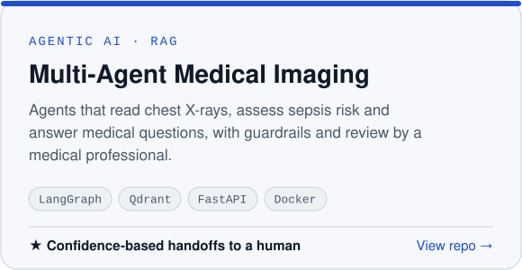
      </picture></a>
    </td>
    <td width="50%">
      <a href="https://github.com/SmitBangare/Trading-Sentinel"><picture>
        <source media="(prefers-color-scheme: dark)" srcset="assets/cards/trading-sentinel-dark.svg">
        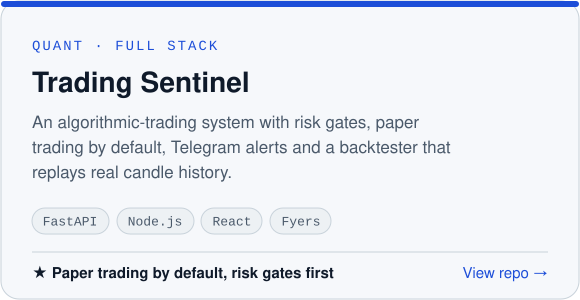
      </picture></a>
    </td>
  </tr>
  <tr>
    <td width="50%">
      <a href="https://github.com/SmitBangare/VigilPay"><picture>
        <source media="(prefers-color-scheme: dark)" srcset="assets/cards/vigilpay-dark.svg">
        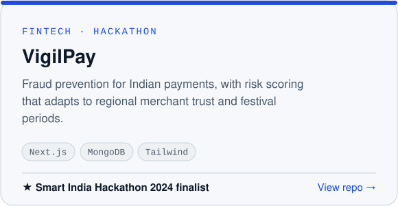
      </picture></a>
    </td>
    <td width="50%">
      <a href="https://github.com/SmitBangare/Contextual-Edge-Detection"><picture>
        <source media="(prefers-color-scheme: dark)" srcset="assets/cards/edge-detection-dark.svg">
        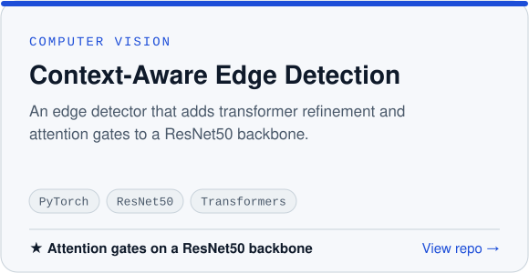
      </picture></a>
    </td>
  </tr>
  <tr>
    <td width="50%">
      <a href="https://github.com/SmitBangare/HVAC_optimization"><picture>
        <source media="(prefers-color-scheme: dark)" srcset="assets/cards/hvac-forecasting-dark.svg">
        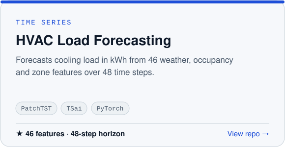
      </picture></a>
    </td>
    <td width="50%">
      <a href="https://github.com/SmitBangare/DC-Beamline-Magnet-Calibration-TIFR"><picture>
        <source media="(prefers-color-scheme: dark)" srcset="assets/cards/tifr-calibration-dark.svg">
        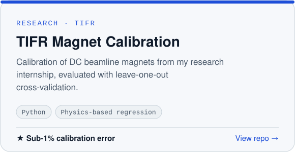
      </picture></a>
    </td>
  </tr>
</table>

More: [Aeronext HVAC Platform](https://github.com/SmitBangare/Aeronext) · [Diet Recommendation System](https://github.com/SmitBangare/Diet-Reccomendation-System-for-Healthy-Lifestyle)

## Experience

<picture>
  <source media="(prefers-color-scheme: dark)" srcset="assets/timeline-dark.svg">
  
</picture>

Experience as text

| Role | Organisation | Period | What I did |
| --- | --- | --- | --- |
| AI/ML Engineer | Tech Shipping OPC | Jun 2025 – present | Built ChandleryOS, the company's operations system; maritime AI copilot, RAG, predictive ML |
| Research Intern | TIFR | Jan – May 2026 | DC beamline magnet calibration, sub-1% error |
| ML Intern | Unified Mentor | Dec 2024 – Jan 2025 | Predictive models and dashboards |
| Research Intern | Skylark Realty | Jun – Aug 2024 | HVAC load forecasting with PatchTST |

## Tech stack

**Languages** 

**ML & AI** 

**Backend & infra** 

## Education

🎓 **B.Tech, Electronics and Computer Engineering**, K. J. Somaiya College of Engineering, Mumbai · 2022 – 2026 · CGPA **8.43 / 10**

## GitHub activity

<picture>
  <source media="(prefers-color-scheme: dark)" srcset="https://raw.githubusercontent.com/SmitBangare/SmitBangare/output/snake-dark.svg">
  
</picture>

<picture>
  <source media="(prefers-color-scheme: dark)" srcset="assets/footer-dark.svg">
  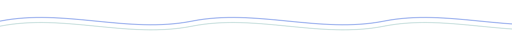
</picture>

Mumbai, India · Open to AI/ML engineering opportunities · <a href="mailto:smitbangare@gmail.com">smitbangare@gmail.com</a>

